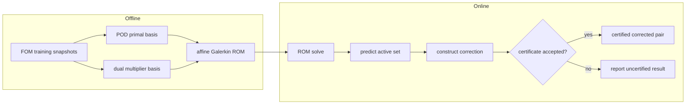

<h1 align="center">ActiveSet_Galerkin_Contact</h1>

<p align="center">
  <b>Can a Galerkin contact ROM be corrected so that its error is certified?</b><br>
  Active-set consistency, certified post-solve corrections and admissibility tests for affine reduced-order contact models.
</p>

<p align="center">
  
  
  
  
  
  
  
</p>

<p align="center">
  <a href="#the-problem">Problem</a> ·
  <a href="#what-the-package-provides">Features</a> ·
  <a href="#quick-start">Quick start</a> ·
  <a href="#experiments">Experiments</a> ·
  <a href="#saved-results">Results</a> ·
  <a href="#repository-layout">Layout</a>
</p>

---

## The problem

A Galerkin reduced-order model (ROM) can be accurate without making the active contact set available to a
post-solve correction. The correction must therefore certify the reduced pair, account for the full finite-element
model, and reject a prediction when the assumptions needed by the certificate do not hold.

This repository implements that pipeline for frictionless unilateral contact. It combines active-set prediction,
multiplier construction, correction methods and fixed acceptance criteria, then saves every run with enough
metadata to reproduce the calculation and compare methods under the same settings.

## What the package provides

| | Component | In one line |
|---|---|---|
| 1 | **Contact benchmarks** | Membrane, homogeneous elastic block and layered elastic block problems with affine stiffness. |
| 2 | **Full-order solver** | Sparse contact solve, KKT residual checks and energy-norm errors. |
| 3 | **Galerkin ROM** | Affine primal and dual-basis projection for parameter-dependent stiffness. |
| 4 | **Active-set rules** | Multiplier, gap and neighbour-based prediction of the strict active set. |
| 5 | **Post-solve corrections** | R0 and R0s correction certificates, with efficient selection and general thin-QR forms. |
| 6 | **Multiplier methods** | S1 and S1-restricted constructions for residual-compatible multiplier estimates. |
| 7 | **Certified acceptance** | Fixed error, effectivity and finite-precision criteria recorded in the experiment configuration. |
| 8 | **Experiment and result tools** | Shared CLI, logging, environment records, NPZ result storage and figure/table helpers. |

### Computation suite dependencies

This project delegates the finite-element and reduced-model machinery to two local packages from the authors'
computation suite:

| Package | Purpose |
|---|---|
| **`fea_engine`** | Finite-element assembly, contact problem definitions, exact sparse contact solves and full-order KKT residual calculations. |
| **`rom_engine`** | Reduced contact models, Galerkin projection helpers and active-set linear-complementarity solves. |

`fea_engine` and `rom_engine` are **not on PyPI** and are not vendored in this repository. Install both as editable
packages from a local copy of the computation suite before running the package or experiments.



## Benchmarks

| ID | Problem | Dimension | Status |
|---|---|---|---|
| **L1-M** | Membrane above an obstacle | 2D | implemented |
| **L1-B** | Elastic block with a rigid obstacle | 3D | implemented |
| **L1-L** | Layered elastic block | 3D | implemented |

The benchmark definitions, basis settings and fixed acceptance thresholds are collected in
`certcorrect/config.py`.

## Quick start

The package requires Python 3.10 or newer, plus NumPy, SciPy and Matplotlib. It also uses the authors' local
`fea_engine` and `rom_engine` packages; those packages are not published on PyPI.

```bash
python -m venv .venv
.venv\Scripts\python -m pip install -r requirements.txt
.venv\Scripts\python -m pip install -e .
```

From a local computation suite, install the two dependencies in editable mode:

```bash
.venv\Scripts\python -m pip install -e <path-to>\computation-suite\fea_engine
.venv\Scripts\python -m pip install -e <path-to>\computation-suite\rom_engine
```

Run the test suite before an experiment:

```bash
.venv\Scripts\python -m pytest
```

Do not use the Anaconda base environment. On Windows, a repeated OpenMP runtime can cause `fea_engine` imports
to fail or NumPy/SciPy to abort.

## Reproducing the short paper (current line of work)

The manuscript in `paper/` (efficiency and limitations of the optimised-multiplier error certificate) uses only the experiments below; the older
X1-X8 table in the next section belongs to the closed post-solve-correction line and is kept for the documented negative results. Seeds are 0, 1, 2.
Every table and figure of the paper is generated from the saved files; no number is typed by hand.

```bash
for s in 0 1 2; do
  for p in membrane block; do
    python experiments/e1_exactness.py --problem $p --seed $s          # E1: exactness / effectivity on FE queries
    python experiments/e2_support_floor.py --problem $p --seed $s      # E2: support floor, controlled sequence
    python experiments/e2_multiplier_check.py --problem $p --seed $s   # E2 diagnostic: restricted multipliers
  done
  python experiments/e3_random_instances.py --seed $s --n-instances 1000   # E3: property tests on random instances
done
python experiments/e_halfrate.py     # half-rate example of Prop. 4.1 (analytic example, certificate code)
python experiments/e_tables.py      # paper/tables/e1_exactness.tex, e2_support_floor.tex, e3_random.tex, benchmarks.tex
python experiments/e_figures.py     # paper/figures/fig_e1_effectivity, fig_e2_support_floor, fig_halfrate (PDF and PNG)
cd paper && latexmk -pdf -outdir=build main.tex
```

Results are written to `results/e1_exactness/`, `results/e2_support_floor/` and `results/e3_random/`. Scope, acceptance criteria and the status of each gate
are in `../SHORT_PAPER_SCOPE.md`; the four protocol changes made after the first E3 runs are disclosed there and in the paper (Sec. 5.4).

## Experiments

Run commands from the repository root. Each script is executable directly and supports `--dry-run`.

| Command | What it does | Status |
|---|---|---|
| `python experiments\x1_rate.py --problem membrane --seed 0` | Certificate and true-error rates across primal basis sizes | implemented |
| `python experiments\x2_effectivity.py --problem membrane --seed 0` | Effectivity versus mesh refinement with `X = K` and `X = I` | implemented |
| `python experiments\x3_active_set.py --problem membrane --seed 0` | Active-set recall and over-snap trade-off | stub |
| `python experiments\x4_multipliers.py --problem membrane --seed 0` | S1 and S1-restricted multiplier comparison | stub |
| `python experiments\x5_certified_share.py --problem membrane --seed 0` | Certified-share and Gate 1 study | stub |
| `python experiments\x6_timing.py --problem membrane --seed 0` | Correction and multiplier timing comparison | stub |
| `python experiments\x7_baselines.py --problem membrane --seed 0` | Zhang slack, enriched Galerkin and conformal baselines | stub |
| `python experiments\x8_finite_precision.py --problem membrane --seed 0` | Verified finite-precision certificate check | stub |

For X1, the active-set rule and thresholds are configurable:

```bash
.venv\Scripts\python experiments\x1_rate.py --problem layered --seed 0
.venv\Scripts\python experiments\x1_rate.py --problem membrane --seed 0 --rule gap --tau-gap 1e-3
.venv\Scripts\python experiments\x1_rate.py --problem membrane --seed 0 --r-dual 24
```

Exit codes are: `0` success, `1` runtime failure, `2` bad input, and `3` not implemented.

## Saved results

`results/` contains NPZ files and logs from completed runs. X1 and X2 produce:

| Folder | Content |
|---|---|
| `results/x1/` | Primal-basis rate sweeps, errors, certificates and acceptance decisions |
| `results/x1_gap_tg0.001/` | Gap-rule runs with `tau_gap = 1e-3` |
| `results/x1_gap_tg0.01/` | Gap-rule runs with `tau_gap = 1e-2` |
| `results/x1_both_tg0.01/` | Combined-rule runs |
| `results/x1_rd12/`, `x1_rd24/`, `x1_rd48/`, `x1_rd96/` | Dual-basis rank sweeps |
| `results/x2/` | Effectivity and mesh-refinement output |
| `results/logs/` | Per-run console logs |

A result file stores experiment arguments and an environment record containing package versions and BLAS/OpenMP
settings. Re-running an experiment writes to the matching path.

## Repository layout

```text
certcorrect/
├── problems.py                         benchmark definitions and affine stiffness
├── fom.py                              full-order solves and KKT checks
├── rom.py                              Galerkin reduced solves
├── bases.py                            primal and dual bases
├── certificate.py                      feasible-pair certificates and acceptance
├── corrections.py                      R0 and R0s correction methods
├── active_set.py                       multiplier, gap and neighbour active-set rules
├── multipliers.py                      S1 and S1-restricted multipliers
├── pipeline.py                         snapshots, bases and per-query evaluation
├── offline_online.py                   Riesz representers and Gram blocks
├── verified.py                         finite-precision verification interfaces
├── baselines/                          Zhang, enriched Galerkin and conformal baselines
├── config.py                           benchmarks, seeds, thresholds and result paths
└── results_io.py, plotting.py, cli.py  saved results, figures and shared CLI
experiments/
├── x1_rate.py                          basis-rate study
├── x2_effectivity.py                   effectivity and mesh refinement
└── x3_active_set.py ... x8_finite_precision.py
    later and baseline experiments
tests/                                focused unit and integration tests
results/                              saved NPZ outputs and logs
paper/                                manuscript figures and tables
```

## Conventions

The sign convention is:

```text
K(mu) u + B^T lambda = f(mu)
B u <= c
lambda >= 0
```

The default inner-product path is `X = K(mu_bar)`. The fixed acceptance threshold is
`Delta <= TAU / (1 + TAU) * ||u^||_K`, with `TAU = 0.05`. Threshold choices and experiment criteria are
defined before a run in `certcorrect/config.py` and the accompanying research notes.

## Scope

Frictionless unilateral contact, affine parameter dependence, direct sparse full-order solves and single-thread
benchmark timings are in scope. The current implementation is a research codebase: some later experiment and
finite-precision modules are interfaces or stubs until their planned work is completed.

## License and citation

Released under the MIT License. See [LICENSE](LICENSE) for details. A citation entry will be added after the
manuscript is published.
